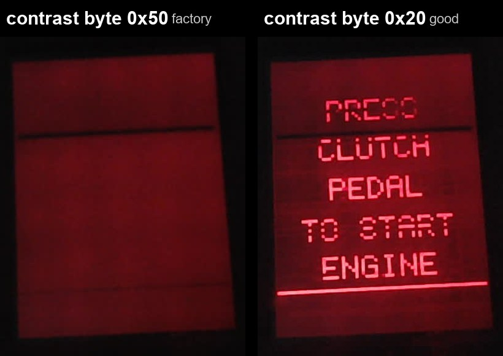
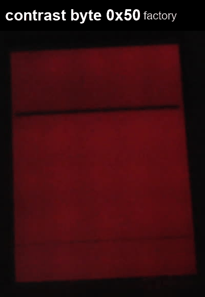

# RxD FIS Adjuster

Fix a faded or blank centre display (FIS) on a B5 Audi VDO instrument cluster by raising its contrast. It works through the OBD port with a cheap K-line cable. No soldering, no new LCD.



Left: a junk B5 cluster at the factory contrast setting. The display looks dead. Right: the same cluster after this tool lowered its contrast byte from 0x50 to 0x20. The text was there all along, just below what the eye can see.

## What it fixes, and what it does not

**Fixes:** a FIS that is evenly faint, washed out or completely blank, while the backlight is on.

**Does not fix:**
- Missing lines or columns of pixels.
- Pixels that drop out when the cluster warms up.

Those come from the heat-sealed ribbon between the glass and the board, or from the driver chip on it. They need a hardware repair.

## How it works

The cluster EEPROM (93C86) holds a 10-point contrast curve at 0x26A:

| Address | Bytes | Meaning |
|---|---|---|
| 0x26A | `0A` | number of points |
| 0x26B-0x274 | `21 3E 79 A5 B7 BF C6 CC D1 D6` | x breakpoints, identical on every unit seen |
| 0x275-0x27E | `50 50 50 50 50 50 4D 4D 40 1F` | contrast byte per point (factory) |

**A lower contrast byte means more LCD drive:** stronger, darker pixels. The cluster picks the value for its current x by interpolating between points. x is probably the display temperature, but that is not proven yet.

On the test cluster at room temperature, the active point sat between the 2nd and 3rd breakpoints (x of about 0x6A). That is on the flat 0x50 part of the factory curve.



Every value from 0x50 down to 0x10, measured on the bench cluster at room temperature:

| Contrast byte | Result |
|---|---|
| 0x50-0x44 | blank (factory is 0x50) |
| 0x3C-0x38 | text first appears |
| 0x30-0x2C | readable but faint |
| 0x28-0x1C | clean |
| 0x18 | ghosting starts |
| 0x14-0x10 | heavy cross-hatch: unlit pixels turn partly on |

Full contact sheet: [images/sweep_sheet.jpg](images/sweep_sheet.jpg). The right value depends on how far your display has faded, so adjust in steps (see below).

The tool shifts the whole curve by the same amount, so the cluster's own temperature correction keeps working. It never writes below 0x10.

## What you need

- A B5 VDO cluster, part number 8D0 920 9xx, ident "B5-KOMBIINSTR. VDO". The script checks both and refuses anything else.
- A "dumb" FTDI-based KKL / VAG-COM 409.1 K-line cable. Note its COM port number in Device Manager.
- Windows with PowerShell 7 (`pwsh`).
- Ignition on. On the bench, the cluster needs +12 V on blue pins 23 and 1, ground on blue 7, 9 and 24, and the K-line on green 28.

## Usage

```
# 1. Read only: makes a backup and shows the current curve
pwsh fis_contrast.ps1 -Port COM3

# 2. Preview a change (no write without -Write)
pwsh fis_contrast.ps1 -Port COM3 -Shift 0x10

# 3. Apply it
pwsh fis_contrast.ps1 -Port COM3 -Shift 0x10 -Write

# Undo: write back the curve from any backup the script made
pwsh fis_contrast.ps1 -Port COM3 -Restore fis_backup_YYYYMMDD_HHMMSS.bin -Write
```

**Steps to follow:**
1. Start with `-Shift 0x10`.
2. Look at the display. It updates a few seconds after the write; no ignition cycle is needed.
3. If it is still too faint, run again with another `-Shift 0x08`.
4. If you see a faint grid or ghost pixels, go back with `-Shift -0x08`.

The test cluster needed a total shift of 0x30 (factory 0x50 to 0x20).

**Every run does all of this:**
- Reads the whole EEPROM twice and saves `fis_backup_<date>.bin` before changing anything. Keep that file.
- Refuses to write unless the curve's x axis matches the known layout exactly.
- Writes one 16-byte row (0x270-0x27F) and changes only the ten contrast bytes.
- Logs in again after the write and verifies the whole EEPROM.

## Notes

- **Tested on one cluster so far:** an 8D0 920 980 C, "B5-KOMBIINSTR. VDO D11", on the bench. The same curve appears at the same address in D12 and D13 dumps, but those have not been adjusted yet. In-car use through the OBD port is not tested yet. Reports are welcome.
- **The cluster counts EEPROM writes** in byte 0x294. Each write adds one.
- **Protocol:** KW1281 at address 0x17, mode login `1B 80 "loginas9"`, then 19200 8E1 packets `D1 <len> <cmd> <data> <xor>`. The commands used are:
  - `72` read 16 EEPROM bytes
  - `77` write 16 EEPROM bytes
  - `53 9D <password>` log in
  - `53 82` restart the display after a write

  The firmware also accepts `52`/`57` (read/write CPU memory), which is how this was found.
- **Bench tip:** if you switch the cluster's 12 V with the cable plugged in, some KKL cables lock up their USB driver until they are replugged.

Use at your own risk. Keep your backup file.
