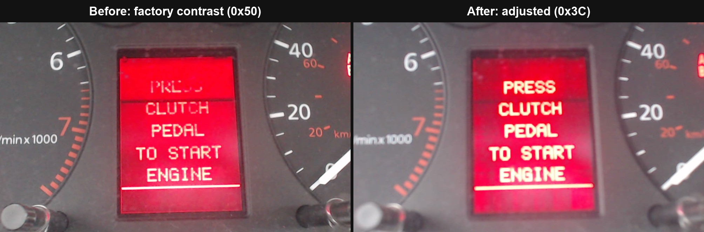
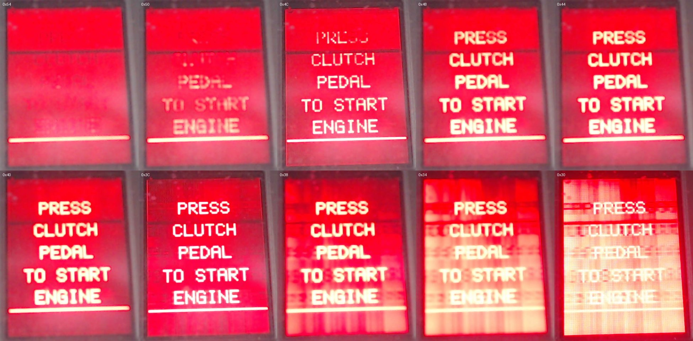
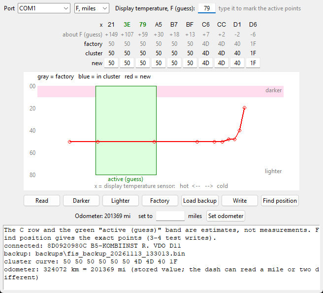

# RxD FIS Adjuster

Fix a faded or blank centre display (FIS) on a B5 Audi VDO instrument cluster by raising its contrast. It works through the OBD port with a cheap K-line cable. No soldering, no new LCD.


Left: a junk B5 cluster at the factory contrast setting. The display looks dead. Right: the same cluster after this tool lowered its contrast byte from 0x50 to 0x20. The text was there all along, just below what the eye can see.



A second cluster, in a car, through the OBD port. At the factory value (0x50) it was losing letters, which looked like the usual ribbon fault. At 0x3C every line is solid.

## What it fixes, and what it does not

**Fixes:**
- A FIS that is evenly faint, washed out or completely blank, while the backlight is on.
- Letters or parts of letters that are missing because the display is right at the edge of fading. The car in the photo above looked like it had a ribbon fault; it was contrast.

**Does not fix:**
- Whole lines or columns of pixels that stay dead whatever contrast you set.
- Pixels that drop out when the cluster warms up and come back when you press on the display.

Those come from the heat-sealed ribbon between the glass and the board, or from the driver chip on it. They need a hardware repair. If you are not sure which you have, try this first: it costs nothing and the backup puts you back to stock.

## How it works

The cluster EEPROM (93C86) holds a 10-point contrast curve at 0x26A:

| Address | Bytes | Meaning |
|---|---|---|
| 0x26A | `0A` | number of points |
| 0x26B-0x274 | `21 3E 79 A5 B7 BF C6 CC D1 D6` | x breakpoints, identical on every unit seen |
| 0x275-0x27E | `50 50 50 50 50 50 4D 4D 40 1F` | contrast byte per point (factory) |

**A lower contrast byte means more LCD drive:** stronger pixels. The cluster picks the value for its current x by interpolating between points.

**x is the display's temperature sensor. Hotter = lower x, colder = higher x.** That direction is measured: warming a cluster on a heated bed moved its x steadily down. So the left of the table is the hot end, and the factory curve only adds drive at the cold end (0xC6 and up).

The temperatures below are **guesses, not a calibration**. They assume an ordinary NTC sensor and are pinned to a single in-car reading (x = 0x79 with the cabin taken as 15 C). Expect them to be off by 5 C near room temperature and by more at the ends.

| x | 21 | 3E | 79 | A5 | B7 | BF | C6 | CC | D1 | D6 |
|---|---|---|---|---|---|---|---|---|---|---|
| about C (guess) | +65 | +42 | +15 | -1 | -8 | -11 | -14 | -16 | -19 | -21 |
| factory | 50 | 50 | 50 | 50 | 50 | 50 | 4D | 4D | 40 | 1F |

In practice: at any normal cabin temperature the cluster sits between the 2nd and 4th points, on the flat part of the factory curve. Exact readings so far: 0x79 in a car on a 10 C day, and 0x5C falling to 0x4B on a bench cluster warmed to about 36 C (the guess predicts 0x48 there).


Every value from 0x50 down to 0x10, measured on the bench cluster at room temperature:

| Contrast byte | Result |
|---|---|
| 0x50-0x44 | blank (factory is 0x50) |
| 0x3C-0x38 | text first appears |
| 0x30-0x2C | readable but faint |
| 0x28-0x1C | clean |
| 0x18 | ghosting starts |
| 0x14-0x10 | heavy cross-hatch: unlit pixels turn partly on |

Full contact sheet: [images/sweep_sheet.jpg](images/sweep_sheet.jpg).

The second cluster (a D13, in the car) needed far less:



| Contrast byte | Result on the in-car D13 |
|---|---|
| 0x54 | blank |
| 0x50 (factory) | faded, letters missing |
| 0x48-0x40 | clean |
| 0x3C | strongest text, first trace of ghosting |
| 0x38 and below | ghosting |

So the usable window is narrow (about 0x10 wide) and sits in a different place on every display. The right value depends on how far yours has faded: adjust in steps (see below).

The tool shifts the whole curve by the same amount, so the cluster's own temperature correction keeps working. It never writes below 0x10.

## What you need

- A B5 VDO cluster, part number 8D0 920 9xx, ident "B5-KOMBIINSTR. VDO". The app checks both and refuses anything else.
- A "dumb" FTDI-based KKL / VAG-COM 409.1 K-line cable.
- Python 3 with `pip install pyserial`. The GUI uses tkinter, which ships with Python on Windows. On Linux install `python3-tk`.
- Ignition on. On the bench, the cluster needs +12 V on blue pins 23 and 1, ground on blue 7, 9 and 24, and the K-line on green 28.

## The app



Run `python fis_adjuster.py` with no arguments for the window. It shows:
- **The table:** the x breakpoints, the factory curve, the curve in your cluster, and the new curve you are editing.
- **The graph:** gray = factory, blue = in the cluster, red = new. Up is darker. The pink band is the 0x10 floor the app will not write below.
- **Units:** the box next to the port switches between F / miles and C / km.
- **About F or C (guess):** the guessed temperature of each point (see above).
- **Active (green band):** the points the cluster is using right now. There are two ways to get it:
  - **A guess, no writes.** Type the display's temperature in C into the box at the top. In a car, **Read** fills it in from the car's outside temperature sensor. That is only right after the car has sat for hours; once the cabin warms up, type your own number. The band is labelled "active (guess)".
  - **Exact, 3-4 test writes: Find position.** It lights one point at a time and asks whether text shows, so the display must have some text on it. Your curve is put back afterwards, and Cancel stops it at any question.
  - The cluster cannot report this itself: a second processor inside it reads the sensor and does the lookup, and it does not pass the reading back to the diagnostic side.

**Steps to follow:**
1. **Read.**
2. Press **Darker** once or twice: each press moves the whole curve 8 steps.
3. **Write.** The display updates a few seconds after the write; no ignition cycle is needed.
4. Repeat until the text is clean. If you see a faint grid or ghost pixels, press **Lighter** and write again.

The bench cluster needed 0x30 in total (factory 0x50 to 0x20). The one in the car needed 0x14 (0x50 to 0x3C).

**Every write does all of this:**
- Reads the whole EEPROM twice and saves `backups/fis_backup_<date>.bin` before changing anything. Keep those files.
- Refuses to write unless the curve's x axis matches the known layout exactly.
- Writes one 16-byte row (0x270-0x27F) and changes only the ten contrast bytes.
- Logs in again and verifies the whole EEPROM.

**Load backup** puts an old curve into "new"; then **Write** restores it. Only the ten contrast bytes are taken from the file.

**Keep your backup files private.** Each one is the whole cluster EEPROM, which includes your immobilizer login PIN and your mileage. If you share results, share the ten contrast bytes, not the file.

### Odometer, for swapped clusters

If you fit a replacement cluster, it shows the donor car's mileage. **Read** shows the stored odometer, and **Set odometer** writes the value you type, in miles or km. Set it to the car's true mileage; misstating mileage is illegal in most places.

- It makes the same backup first, writes only the 16 odometer bytes (0x042-0x051), and verifies the whole EEPROM afterwards.
- Check first that the value the app reads matches your dash to within a mile or two. If it does not, your cluster stores it differently: do not write.
- The dash can land a mile or two from what you typed. The stored value has 2 km steps, and the offset between it and the dash was measured on one cluster. Look at the dash afterwards and set it again if needed.
- Tested on the bench D11 only.

### Command line

```
python fis_adjuster.py read    --port COM3                    # Linux: --port /dev/ttyUSB0. Also prints the temperature guesses
python fis_adjuster.py shift 0x10 --port COM3                 # preview, positive = darker
python fis_adjuster.py shift 0x10 --port COM3 --write
python fis_adjuster.py set "28 28 28 28 28 28 25 25 18 10" --port COM3 --write
python fis_adjuster.py restore backups/fis_backup_X.bin --port COM3 --write
python fis_adjuster.py probe   --port COM3                    # find the active point (asks y/n)
python fis_adjuster.py odometer 201370 --miles --port COM3 --write   # swapped cluster: set the true mileage (km without --miles)
```

## Notes

- **Tested on two clusters so far**, both from Windows:
  - 8D0 920 980 C, "VDO D11", on the bench.
  - 8D0 920 980 CX, "VDO D13", in a car through the OBD port. Its factory curve is `50 50 50 50 50 50 4E 4E 40 1F`; the app's "factory" row shows the D11 values, so use your own backup to go back to stock.
  - Linux should work through pyserial but has not been tried. The same table appears at the same address in D12 dumps, not adjusted yet. Reports are welcome.
- **The temperature figures are guesses.** Only the direction is measured. If you can read your cluster at a known cold or hot temperature, please report x and the temperature.
- **The cluster counts EEPROM writes** in byte 0x294. Each write adds one, odometer writes included.
- **Odometer storage:** 8 little-endian words at 0x042, each the inverse of a counter in 16 km units; the number of words one step ahead adds 2 km each. Stored value = shown km + 52 (measured; other tools use + 50).
- **Protocol:** KW1281 at address 0x17, mode login `1B 80 "loginas9"`, then 19200 8E1 packets `D1 <len> <cmd> <data> <xor>`. The commands used are:
  - `72` read 16 EEPROM bytes
  - `77` write 16 EEPROM bytes
  - `53 9D <password>` log in
  - `53 82` restart the display after a write

  The firmware also accepts `52`/`57` (read/write CPU memory), which is how this was found.
- **Bench tip:** if you switch the cluster's 12 V with the cable plugged in, some KKL cables lock up their USB driver until they are replugged.

Use at your own risk. Keep your backup file.
