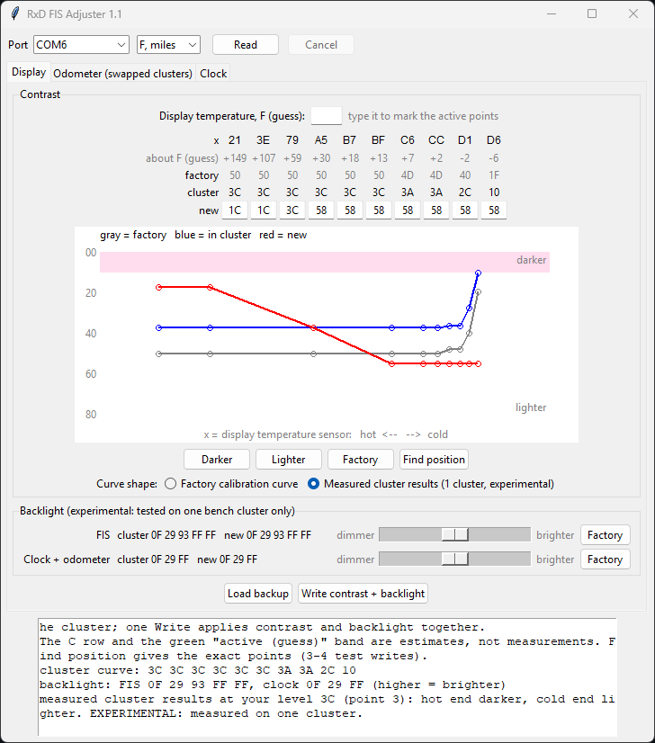
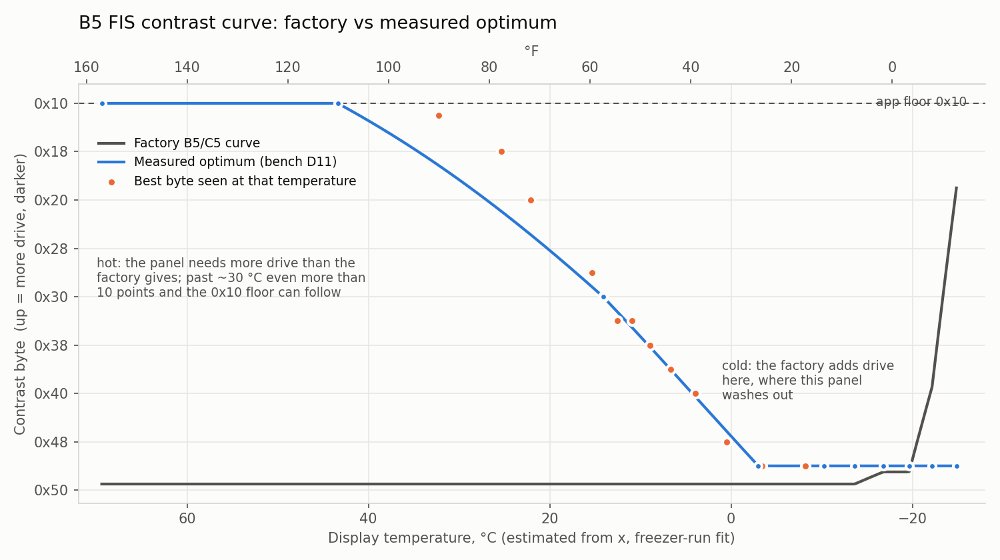
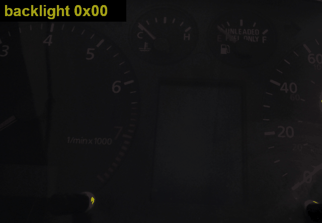

# RxD FIS Adjuster

Fix a faded or blank centre display (FIS) on a B5 Audi VDO cluster by raising its contrast, through the OBD port with a cheap K-line cable. No soldering, no new LCD. C5 A6/allroad clusters: experimental, see [What you need](#what-you-need).


Left: a junk B5 cluster at the factory contrast (0x50), looking dead. Right: the same cluster at 0x20. The text was there all along.


A second cluster, in a car. At 0x50 it was losing letters, which looked like a ribbon fault. At 0x3C every line is solid.

## What it fixes

- **Fixes:** a FIS that is evenly faint, washed out or blank while the backlight is on, or missing letters because it is right at the edge of fading.
- **Does not fix:** lines or columns that stay dead at any contrast, or pixels that drop out when warm and come back when you press the glass. That is the ribbon or its driver chip: a hardware repair.

Not sure which you have? Try this first. It is free, and the backup puts you back to stock.

## How it works

The cluster EEPROM (93C86) holds a 10-point contrast curve at 0x26A: a count (`0A`), 10 x breakpoints (`21 3E 79 A5 B7 BF C6 CC D1 D6`) and 10 contrast bytes (factory `50 50 50 50 50 50 4D 4D 40 1F`).

- **Lower byte = more drive = darker pixels.**
- **x is the display's temperature sensor: left = hot, right = cold** (measured on a heated bed and from a freezer). The factory curve only adds drive at the cold end.

| x | 21 | 3E | 79 | A5 | B7 | BF | C6 | CC | D1 | D6 |
|---|---|---|---|---|---|---|---|---|---|---|
| about C (estimate) | +65 | +42 | +15 | -1 | -8 | -11 | -14 | -16 | -19 | -21 |

The temperatures are estimates. A freezer run backs them to within a few degrees from 0 to 40 C; the ends are rougher.


The usable window is narrow and different on every display:

| Byte | Bench D11 (room temp) | In-car D13 |
|---|---|---|
| 0x54-0x50 | blank | blank to faded, letters missing |
| 0x48-0x40 | blank | clean |
| 0x3C-0x38 | text appears | best at 0x3C, then ghosting |
| 0x30-0x2C | faint | ghosting |
| 0x28-0x1C | clean | |
| 0x18-0x10 | ghosting, then cross-hatch | |

Contact sheets: [bench](images/sweep_sheet.jpg), [car](images/car_sweep.jpg).

## What you need

- A B5 VDO cluster (8D0 920 9xx, ident "B5-KOMBIINSTR. VDO"), or a C5 A6/allroad VDO cluster (4B0 920 9xx or 4Z7 920 9xx, ident "C5-KOMBIINSTR. VDO"). The app refuses anything else, including early 4B0 920 900 and later "KOMBI+WEGFAHRS" units.
- An FTDI-based KKL / VAG-COM 409.1 K-line cable.
- Python 3 with `pip install pyserial` (tkinter ships with Python on Windows; on Linux install `python3-tk`).
- Ignition on. On a bench: +12 V on blue 23 and 1, ground on blue 7, 9 and 24, K-line on green 28.

> **C5 support is EXPERIMENTAL.** Every C5 read and write is untested, on the bench and in a car: no C5 cluster has been connected to this tool yet. It is based only on 13 C5 EEPROM dumps that match the B5 layout byte for byte. **If you try it on a C5, please [open an issue](https://github.com/RENOxDECEPTION/RxD_FisAdjuster/issues) whether it worked or failed**, with your part number and ident.

## Using the app



Run `python fis_adjuster.py`.

1. **Read.**
2. Press **Darker** once or twice (8 steps each).
3. **Write contrast + backlight.** The display updates in a few seconds.
4. Repeat until the text is clean. If you see a faint grid or ghost pixels, press **Lighter** and write again.

The bench cluster went from 0x50 to 0x20, the car one from 0x50 to 0x3C.

Also in the window:
- **Graph:** gray = factory, blue = in the cluster, red = new. Up is darker. The pink band is the 0x10 floor the app never writes below.
- **Active points (green band):** type the display temperature to estimate them, or use **Find position** (3-4 test writes, asks whether text shows, puts your curve back).
- **Cancel:** stops a Read or Write that is still trying to connect. Once connected, a job always finishes.
- **Load backup** + **Write** puts an old contrast curve and backlight back.

**Every write:** reads the EEPROM twice and saves `backups/fis_backup_<date>.bin` first (keep these), refuses an unknown layout, writes only the rows that changed, restarts the display, verifies the whole EEPROM and puts the clock back.

### Curve shape (experimental, one cluster)



The **Curve shape** switch picks **Factory calibration curve** (default) or **Measured cluster results**. It keeps your level at point 3 and only changes the shape: the hot points 0x20 darker, the cold points 0x1C lighter.

How it was measured: the bench cluster came out of a freezer and was swept through every contrast byte, with a webcam photo at each one, as it warmed to room temperature. A heated-bed run continued the sweep up to about 36 C. The orange dots are the best byte at each temperature. It needed **more drive the hotter it got**, and when cold, extra drive washed the whole display out. The factory curve does the opposite. With a curve set on a cool day, expect fading on hot days.

**Measured on one cluster only** (an old, faded D11). A healthy panel may need a gentler slope. Set your level first, then try it, and check on a hot day and a cold morning.

### Backlight (experimental)



Two sliders: one for the FIS, one for the clock and odometer. The middle is what is in the cluster now, and **Factory** restores the default. The factory tables already end at full brightness, so the slider mostly lifts the dim and middle range. Tested on the bench D11 only.

### Clock

The **Clock** tab sets the cluster's time and date from the PC. It is a memory write, not an EEPROM write. After a battery disconnect the cluster always starts at 12:00, 1.01.1999 (fixed in its firmware). Tested on the bench D11 only. The app checks that it has found a ticking clock before it writes.

### Odometer, for swapped clusters

The **Odometer** tab sets a replacement cluster to the car's true mileage, in miles or km. Misstating mileage is illegal in most places.

- Check first that the value the app reads matches your dash within a mile or two. If it does not, do not write.
- It can land a mile or two off. Look at the dash and set it again if needed.
- Same backup and verify as above. Tested on the bench D11 only.

### Command line

```
python fis_adjuster.py read    --port COM3                    # Linux: --port /dev/ttyUSB0
python fis_adjuster.py shift 0x10 --port COM3 --write         # positive = darker; without --write it only previews
python fis_adjuster.py set "28 28 28 28 28 28 25 25 18 10" --port COM3 --write
python fis_adjuster.py shape measured --port COM3 --write     # or: shape factory
python fis_adjuster.py restore backups/fis_backup_X.bin --port COM3 --write
python fis_adjuster.py probe   --port COM3                    # find the active point (asks y/n)
python fis_adjuster.py odometer 201370 --miles --port COM3 --write
python fis_adjuster.py backlight fis 0x10 --port COM3 --write # fis or clock, positive = brighter
python fis_adjuster.py clock --port COM3 --write
```

## Notes

- **Tested on:** 8D0 920 980 C "VDO D11" on the bench, and 8D0 920 980 CX "VDO D13" in a car (contrast only). Windows only so far.
- The D13's factory curve is `50 50 50 50 50 50 4E 4E 40 1F`. The app's "factory" row shows the D11 values, so use your own backup to return to stock.
- The cluster counts EEPROM writes in byte 0x294.
- **Odometer storage:** 8 little-endian words at 0x042, each the inverse of a 16 km counter. Stored = shown km + 52.
- **Protocol:** KW1281 at 0x17, mode login `1B 80 "loginas9"`, then 19200 8E1 packets `D1 <len> <cmd> <data> <xor>`: `72`/`77` read/write 16 EEPROM bytes, `53 9D <password>` log in, `53 82` restart the display. `52`/`57` read/write CPU memory; the D11 clock is at RAM 0x0213.
- **Bench tip:** switching the cluster's 12 V with the cable plugged in can lock up some KKL cables until they are replugged.

Use at your own risk. Keep your backup file.

## Changes

**1.1 (2026-11-14)**
- Curve shape switch: factory calibration curve or measured cluster results (`shape` on the command line). The measured shape comes from **one cluster**, tested from -8 to 36 C. Experimental; factory stays the default.
- C5 A6/allroad VDO clusters accepted: **experimental and untested**.
- The odometer write now checks the EEPROM layout too.
- The version is shown in the window title.

**1.0**
- Contrast read/write with backup and verify, Find position, odometer, backlight (experimental) and clock.
